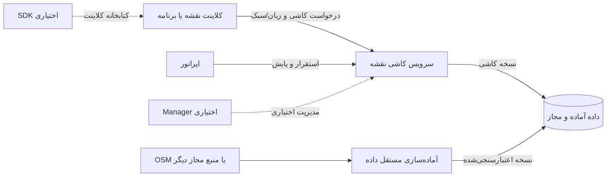
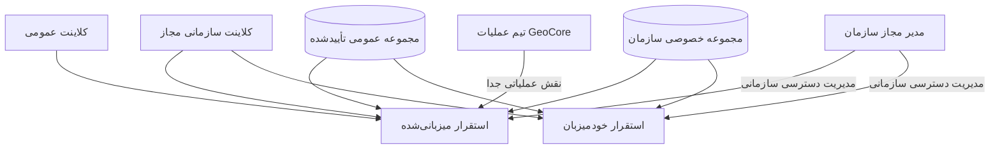
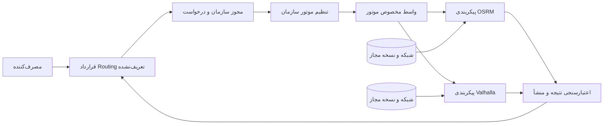

# نمای کلی معماری (پیشنهادی و غیرالزام‌آور)

**وضعیت:** معماری سرویس تصویب یا پیاده‌سازی نشده است. این سند محدودیت‌های محصول و جهت منطقی را ثبت می‌کند؛ مبنای پشته توسعه جداگانه آمده است. مشخصات استقرار یا قرارداد API نیست. ترجمه‌پیش‌نویس است و پیش از انتشار نیازمند بازبینی انسانی و فنی است.

## محدودیت‌ها و تصمیم‌های محصول

- سرویس مرز مسئولیت است و الزاماً مخزن، فرایند، کانتینر یا زبان جدا نمی‌خواهد.
- هیچ سرویس GeoCore نباید به نصب اجباری سرویس دیگر وابسته باشد؛ داده، موتور و زیرساخت همچنان می‌توانند پیش‌نیاز باشند و باید اعلام شوند.
- ترتیب آغاز: کاشی برداری، سپس Routing. Manager و SDK اختیاری‌اند و نباید در مسیر درخواست اجباری باشند.
- OSM منبع اولیه و ایران هدف است؛ کیفیت و پوشش تأیید نشده‌اند. مجوز داده با شرایط سرویس عمومی فرق دارد.
- تصمیم مالک محصول، مدل میزبانی‌شده و خودمیزبان را هر دو برای انتشار نخست هدف می‌گیرد؛ توپولوژی، نقش‌ها، عملیات، هزینه و آمادگی هر دو باز است.
- انتشار نخست کاشی باید برداری باشد و داده عمومی و خصوصی سازمانی را پشتیبانی کند. نقش مدیر سازمان و تیم GeoCore جداست؛ مجوزهای دقیق و جداسازی مستلزم طراحی و آزمون است.
- آزمون اولیه بر تهران، کرج، تبریز، مشهد و اصفهان متمرکز است؛ این نمونه اثبات کیفیت سراسری ایران نیست.
- مبنای توسعه به‌تعیین مالک: TypeScript Strict زیر Bun، Vitest برای آزمون، Fastify برای APIهای HTTP و Zod برای اعتبارسنجی و استنتاج نوع است؛ [مبنای پشته توسعه](DEVELOPMENT-STACK.fa.md) را ببینید. نسخه‌ها و انتخاب adapter اتصال Fastify/Zod به شواهد و بازبینی بسته نیاز دارند.

## زمینه منطقی

نمودار منطقی است. آماده‌سازی داده می‌تواند ابزار مستقل، فرایند GeoCore یا داده تحویلی مصرف‌کننده باشد؛ هنوز تصمیمی گرفته نشده است.

## استقرار و دسترسی

مدل منطقی هدف، نه توپولوژی مصوب:

مسئولیت عملیات GeoCore در مدل خودمیزبان، تقسیم دقیق نقش‌ها، هویت، جداسازی سازمان و شواهد آمادگی هر دو مدل هنوز باز است. عمومی‌بودن داده فقط پس از بررسی منبع و مجوز تعیین می‌شود؛ درخواست خصوصی حتی در Cache باید مجوز داشته باشد.

## جهت انتخاب موتور Routing

مالک محصول می‌خواهد انتشار نخست Routing هر دو OSRM و Valhalla را با انتخاب سازمانی عرضه کند. این تعهد نیازمند امکان‌سنجی جدی است. نمودار زیر فقط مرز پیشنهادی adapter را نشان می‌دهد؛ API مشترک، رفتار هم‌ارز یا قاعده جایگزینی موتور تصویب نشده است. خرابی یک موتور نباید بی‌صدا به موتور دیگر سوئیچ کند.

موتور، تنظیم، نسخه شبکه، پروفایل، هدف و جابه‌جایی نقطه باید قابل شناسایی باشند. توانایی هر دو موتور برای سه پروفایل و بهینه‌سازی چندمقصده هنوز ثابت نشده است؛ شکاف باید پیش از انتشار با تصمیم صریح حل شود.

## مرز سرویس و جریان داده پیشنهادی

داده منتشرشده نسخه‌دار و قابل ردیابی به منبع، مجوز، پردازش و اعتبارسنجی باشد. داده نامعتبر جایگزین نسخه معتبر نشود. وابستگی میان سرویس‌ها صریح و اختیاری است؛ حالت مستقل و کاهش قابلیت در نبود آن مستند شود. منبع بیرونی فقط پس از بررسی سیاست، نرخ، قابلیت اتکا، حریم خصوصی و قانون مناسب تولید انتخاب شود.

جریان پیشنهادی: دریافت مجاز و ثبت منشأ؛ اعتبارسنجی قالب/هندسه/پوشش/یکپارچگی؛ ساخت نامزد نسخه‌دار؛ آزمون پوشش، نمایش، زبان و امنیت؛ انتشار تغییرناپذیر و تعویض کنترل‌شده نسخه فعال؛ پایش آمادگی و خطا بدون ثبت مختصات دقیق یا اسرار. جزئیات ذخیره‌سازی و اتمی‌بودن نیازمند ADR و آزمون است.

## تصمیم‌های فنی باقی‌مانده

قالب و طرح کاشی و سطوح بزرگ‌نمایی؛ روش استخراج و پردازش ایران؛ منبع مرجع مجاز؛ موتور و ذخیره‌سازی؛ Cache و معناهای خالی/خارج پوشش؛ مدل هویت و نقش؛ محیط ساخت/استقرار و منابع؛ اهداف عددی؛ مسئولیت عملیات دو مدل. هیچ گزینه‌ای صرفاً با ذکر در این سند انتخاب نمی‌شود.
