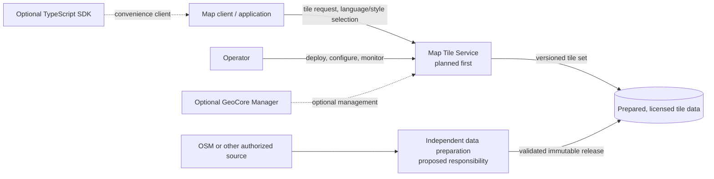
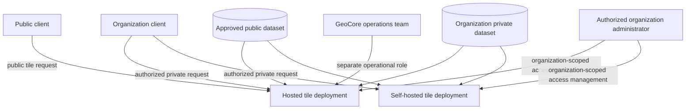
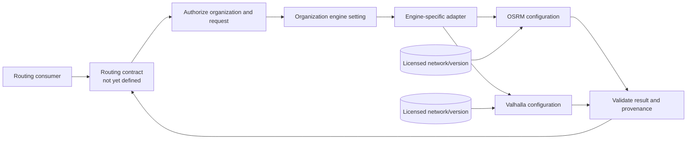

# Architecture overview (proposed, non-binding)

**State:** Service architecture has not been approved or implemented. This document captures product constraints and logical direction; the owner-directed development stack is recorded separately. It is not a deployment specification or API contract.

## Constraints from product scope

- A service is a responsibility boundary, not necessarily a separate repository, process, container, or language runtime.
- Every service must work without mandatory installation of other GeoCore services. Data, specialized engines and infrastructure may still be mandatory prerequisites and must be declared.
- Initial delivery priority is vector map tiles, then routing. A consumer must be able to use the tile service without installing Manager, SDK, Routing or Data Management.
- OSM is the initial base source for Iran; coverage and quality are unverified. Data and public-service licenses/policies are independent concerns.
- The latest owner decision now targets both hosted and self-hosted models in the first release; topology, role boundaries, operating procedures, cost and readiness evidence remain undecided.
- Owner decisions require a vector-only first tile release supporting both public and organization-private datasets, with separate organization-admin and GeoCore-team roles. Exact authorization policy and tenant/cache isolation still require design and tests.
- The initial tile-data validation focus is Tehran, Karaj, Tabriz, Mashhad and Isfahan, while the product target remains all Iran. The five-city sample cannot establish nationwide coverage.
- The owner-directed development baseline is strict TypeScript under Bun, Vitest for tests, Fastify for HTTP APIs, and Zod for validation and inferred types; see the [development stack](DEVELOPMENT-STACK.md). Versions and Fastify/Zod adapter choices require package-level evidence and review.
- Candidate technologies in the original scope are not all selections. Database, tile format, tile-generation pipeline, API paths/contracts, auth provider and cloud remain unselected here; using Fastify does not define API semantics.

## Logical context

The drawing is logical only. Whether data preparation is a GeoCore service, an external tool or a consumer-provided artifact remains to be decided. Manager/SDK are optional; neither is on the request path by requirement.

## Deployment and access direction (owner decision; design pending)

Both hosted and self-hosted deployment models are targeted for the first release. The first tile release must support public and organization-private datasets. Organization administrators and the GeoCore team have distinct access-management roles; exact permissions, trust boundaries and operational responsibilities are not yet designed.

This is a logical target, not an approved topology or a deployment promise. The self-hosted operating role for GeoCore, the exact role division, dataset provisioning, identity source, tenant isolation, and whether both models can meet first-release evidence remain design and validation work. A public dataset is public only after source/license review; a private request must be authorized independently of an unguessable URL or cache hit.

## Routing engine selection direction (feasibility pending)

The product owner requires the first Routing release to provide both OSRM and Valhalla as organization-selectable engines. This creates a substantial compatibility gate: each engine/configuration must be tested against required profiles and trip semantics. The diagram describes a possible adapter boundary only; a shared normalized API, equivalent behavior and fallback policy have not been approved. An engine failure must not silently switch engines or present a different result as equivalent.

The two network artifacts may differ; the effective engine, engine/configuration version, network version, profile, objective, and any snapping must be reportable. Whether both engines can satisfy identical multi-stop and time-optimization requirements is unverified. If one cannot, stop and obtain an explicit product decision before release rather than silently omitting the engine or capability.

## Service boundaries and integration

- Keep published data versioned and traceable to source, license, processing and validation. A new invalid dataset must not replace the last valid published version.
- Consumers must be able to determine dataset version, coverage and terms. Cache behavior must respect freshness, authorization and license; private data must not leak across consumers.
- Service-to-service integration is explicit and optional. If a service consumes another GeoCore service, document the capability loss and failure behavior when that integration is absent.
- Externally hosted data is not implicitly a suitable production dependency. Assess policy, rate limits, reliability, privacy and legal terms before use.

## Proposed release/data flow

1. Acquire only from an authorized source; record source timestamp, license and attribution obligations.
2. Validate format, geometry, coverage, integrity and expected data characteristics. Reject or quarantine invalid input.
3. Build a versioned candidate artifact reproducibly where feasible; record tool/configuration versions and processing result.
4. Run representative coverage, rendering, language/font/style and security checks.
5. Publish an immutable version and switch the active pointer atomically; retain rollback to the prior valid version.
6. Observe freshness/readiness and request/error/latency metrics without logging precise locations or secrets.

Steps are product constraints/proposed flow, not an implemented pipeline. Detailed storage, atomicity, consistency and rollback semantics require an ADR and tests.

## Decisions required before implementation

- Tile output format(s), zoom range, tile matrix/numbering scheme, style and font/resource delivery.
- Data extraction/update approach for Iran, attribution path, license assessment, cadence, reproducibility and data size.
- Serving engine, storage/object-store or filesystem model, cache policy, ETag/versioning and empty/out-of-coverage semantics.
- Authentication/authorization and tenant separation, including whether any tile set is public or proprietary.
- Container model, supported OS/CPU, health/readiness, deployment/rollback and resource targets.
- Hosted/self-hosted responsibility split and approved numerical performance objectives.

Record a decision in an ADR before treating any option as selected. See [governance](GOVERNANCE.md), [data governance](DATA-GOVERNANCE.md), [security](SECURITY.md) and [roadmap](ROADMAP.md).
