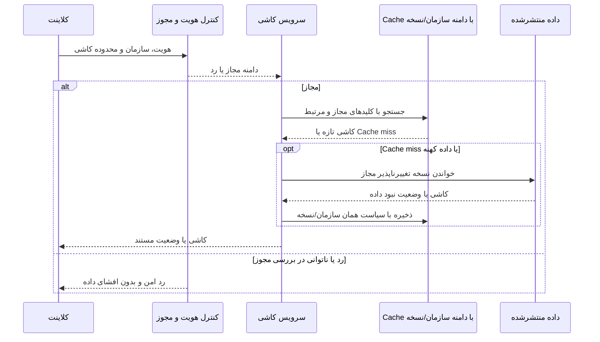

# مبانی امنیت و حریم خصوصی

**وضعیت:** مبنای نیازمندی برای طراحی و بازبینی؛ پیاده‌سازی یا گواهی امنیتی ادعا نمی‌شود. این سند مشاوره حقوقی نیست. نسخه ترجمه‌پیش‌نویس است و نیازمند بازبینی انسانی/فنی.

## اصول امنیت

- پیش‌فرض منع دسترسی؛ هر عملیات را نسبت به کاربر، سازمان، شیء و عمل مجاز کنید. شناسه تصادفی جای مجوز نیست.
- سازمان‌ها و داده اختصاصی را در مبدأ، ذخیره، خروجی مشتق، API، Cache، لاگ، پشتیبان و مدیریت از هم جدا کنید.
- داده و دقت حداقلی جمع‌آوری شود. تاریخچه، اشتراک زنده و کشف نزدیکان مجوزهای مستقل‌اند.
- انتقال و ذخیره داده حساس متناسب با ریسک محافظت شود. اسرار را در کد، بسته کلاینت، تصویر یا لاگ نگذارید؛ تحویل و چرخش امن اسرار را طراحی کنید.
- هنگام ناتوانی در بررسی مجوز، دسترسی بسته بماند. وجود شیء حساس از طریق پاسخ، شمارش، صفحه‌بندی، Cache یا لاگ افشا نشود.
- داده منبع، فایل بارگذاری‌شده، هندسه، URL و پاسخ ارائه‌دهنده بیرونی ورودی نامطمئن‌اند.

## مدل تهدید اولیه کاشی

دارایی‌ها: داده پایه مجاز، کاشی/لایه اختصاصی، اعتبارنامه، پیکربندی، دسترس‌پذیری و فراداده انتساب. مرز اعتماد: شبکه عمومی تا API؛ سازمانی به سازمان دیگر؛ مدیر سازمان در برابر تیم عملیات GeoCore که نقش‌های جدا دارند؛ ابزار دریافت تا داده منتشرشده؛ سرویس تا Cache/ذخیره‌سازی. انتشار نخست هر دو مدل میزبانی و هر دو نوع داده عمومی/خصوصی را هدف دارد؛ کنترل‌ها باید برای هر مدل آزموده شوند.

تهدیدهای آزمون: خواندن کاشی خصوصی بدون مجوز؛ برخورد کلید Cache میان سازمان‌ها؛ داده کهنه پس از لغو یا تعویض نسخه؛ دست‌کاری مسیر/کلید؛ مصرف منابع با درخواست پرتعداد یا بزرگ؛ نفوذ منبع؛ افشای مدیریت؛ نشت اسرار در لاگ؛ مسیرگردی فایل آرشیوی در پردازش آینده؛ حذف انتساب.

کنترل‌های پیشنهادی: اعمال مجوز پیش از Cache یا معماری‌ای که دورزدن مجوز را ناممکن کند؛ لحاظ سازمان/نسخه/زبان/قالب در کلیدهای لازم؛ سقف درخواست و منابع؛ اعتبارسنجی مسیر/پارامتر؛ کمترین دسترسی؛ داده نسخه‌دار تغییرناپذیر؛ ثبت رخداد حداقلی؛ آزمون بازگشت نسخه و انتشار لغو دسترسی. معماری نهایی هنوز انتخاب نشده است.

این نمودار قید امنیتی پیشنهادی است نه طراحی مصوب. Cache hit نباید کنترل دسترسی داده خصوصی را دور بزند.

## مشاهده‌پذیری حساس

به‌طور پیش‌فرض مختصات دقیق، متن کامل نشانی/جستجو، رمز، توکن، راز پیوند مهمان و شناسه شخصی غیرضروری را در لاگ ننویسید؛ برچسب شاخص و ردگیری هم باید حداقلی باشد. نگهداری و دسترسی گزارش حسابرسی تعریف شود و رخداد امنیتی مختصات حذف‌شده را بازتولید نکند. ابزار ثالث پایش و گزارش خطا پیش از فعال‌سازی بازبینی شود.

## چرخه داده و آمادگی رخداد

پیش از پردازش داده شخصی، هدف، نقش مسئولان داده، مبنای قانونی، دامنه دسترسی، آغاز/پایان نگهداری، حذف داده اصلی/مشتق/Cache/لاگ/پشتیبان، حقوق افراد، مسئول رخداد و رفتار بازیابی مشخص شود. پشتیبان محدود و پس از بازیابی حذف و انقضا دوباره اعمال شوند. گزارش آسیب‌پذیری، به‌روزرسانی وابستگی، بررسی امنیت، پاسخ رخداد و تکالیف اطلاع‌رسانی حوزه مربوط مستند شوند.

## دروازه انتشار امنیت

بازبینی مدل تهدید؛ آزمون مجاز و غیرمجاز از جمله بین‌سازمانی؛ بررسی سوءاستفاده از ورودی/منابع؛ اسکن اسرار و لاگ؛ بازبینی وابستگی/کانتینر؛ پیکربندی TLS؛ Cache و لغو؛ حذف و بازیابی در صورت کاربرد؛ تعیین تکلیف یافته‌ها و تأیید مسئول لازم است. مانع قانونی یا امنیتی با برچسب آزمایشی رفع نمی‌شود.

ردیابی: `REQ-P1` تا `REQ-P5`، `SEC-01` تا `SEC-05`، `OPS-06`، `DATA-06` و الزامات سرویس مربوط.
